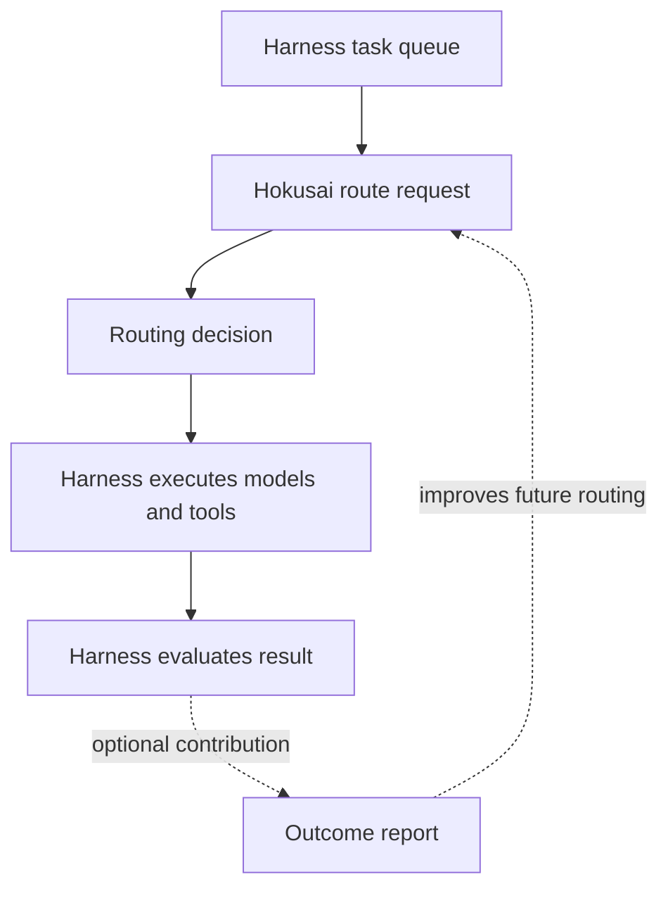

# Integrating with a Harness

Start with local task-cost measurement, then opt into routing and contribution separately. Hokusai integrates as a routing decision service. It does not replace your coding harness, agent runtime, tools, prompts, or evaluation system.

## Measuring task cost

Install the verified published release (2026-11-16):

```bash
npm install @hokusai/costs@0.8.0
```

No account, API key, network connection, or default disk writes are required for measurement.
If your host already uses core, align its direct dependency to `@hokusai/core@0.8.0`
in the same change: costs 0.8.0 requires core **exactly** 0.8.0. Align adapters too;
all SDK packages use fixed versioning. Core 0.5.0 was the first task-cost release,
not a recommendation to downgrade. The [SDK versioning policy](https://github.com/Hokusai-protocol/hokusai-sdk/blob/main/docs/versioning-policy.md)
and [release notes](https://github.com/Hokusai-protocol/hokusai-sdk/blob/main/docs/release-notes.md)
are the version/export authority; the historical 0.5.0 release entry remains relevant.

Wrap your own event-emitting harness:

```ts
import { measureTask } from '@hokusai/costs';

const { result, cost } = await measureTask({ events: harness }, () => harness.run(task));
console.log(result, cost.totalUsd, cost.coverage, cost.pricing);
```

`events` subscribes to usage during execution (or consumes a supplied iterable).
It cannot automatically meter clients that emit no usage. Record observations yourself
when needed:

```ts
import { createTaskCostTracker, fromAnthropicUsage } from '@hokusai/costs';

const tracker = createTaskCostTracker({ taskId: 'task-demo', harness: 'native' });
tracker.recordUsage({
  model: 'claude-sonnet-5',
  usage: fromAnthropicUsage({ input_tokens: 1200, output_tokens: 400 }),
});
const cost = tracker.summary();
console.log(cost.totalUsd, cost.coverage, cost.pricing);
```

For Claude Code or Codex session-file capture, explicitly supply `harness`,
non-empty `sessionIds`, `paths` and/or `roots`, and a task time `window`.
The SDK never picks the newest file or scans a default home directory.
No captured usage means `coverage.status: 'unavailable'` and `totalUsd: null`.
An optional local ledger persists allow-listed evidence only when opened and passed
as `ledger`; see the [costs README](https://github.com/Hokusai-protocol/hokusai-sdk/blob/main/packages/costs/README.md)
and the [website quick start](https://hokus.ai/router/integrate/cost-tracking)
for session boundaries, ledger setup and queries.

Advanced hosts can produce `TaskCostEventV1` observations and reduce them with
`aggregateTaskCost(events, options)` from core. Follow the
[SDK task-cost contract](https://github.com/Hokusai-protocol/hokusai-sdk/blob/main/packages/core/src/task-cost/README.md)
for schemas, cumulative-counter handling, deduplication and provenance rather than
inventing a parallel record format.

### Usage normalization

Use `fromAnthropicUsage` for Anthropic Messages usage (including separate cache
reads/writes) and `fromOpenAIUsage` for OpenAI API usage. OpenAI input includes
cached reads; its mapper separates the cached slice once. Reasoning is an
informational subset of output, never an extra billable bucket. Keep missing
or malformed counters null rather than manufacturing zeros.

**Upcoming, not exported by 0.8.0:** `fromCodexUsage(usage, diagnostics?)` and
`CodexUsageDiagnostics`. No runnable import or minimum release is claimed here.
The public mapper will normalize Codex CLI inclusive input by subtracting cached
reads/writes once, clamp underflow with the optional count-only
`codex_cache_exceeds_input` counter, preserve missing/malformed counters as null,
and keep reasoning inside output. Difference cumulative counters **before** mapping.
Do not use `fromOpenAIUsage` for Codex CLI payloads or copy a private bucket formula.
The explicit Codex session-file path above is supported in 0.8.0.

### Amounts, coverage and price provenance

API-equivalent resource cost is the common comparison/training measure across
subscriptions, discounts and subsidies. Preserve usage regardless of funding;
no auth-mode detection, monthly-fee allocation or subscription classification is required.

- `estimatedUsd` is token-derived cost using the dated built-in table or explicit overrides.
- `actualUsd` records provider-reported charge evidence.
- `totalUsd` resolves each event by preferring its provider charge over its estimate;
  the result can contain both sources. Keep `source`, `pricing` and `coverage` alongside it.
- Unresolved or partial totals stay null, never zero. Available priced subtotals
  remain explicitly partial lower bounds. Unsupported dimensions are unpriced.

The current report retains pricing revision/effective-date evidence; consult
[core pricing documentation](https://github.com/Hokusai-protocol/hokusai-sdk/blob/main/packages/core/README.md)
and the costs README for supported rates and overrides.
The upcoming generated `@hokusai/core/token-prices` JSON artifact
(`hokusai_token_prices/v1`) is intended as the shared SDK/server rate source,
with explicit rates/null dimensions, aliases, per-row source/date and exact
version/hash provenance. It is **not published in 0.8.0**. Adopt it only after
release verification; merged SDK/server changes do not establish a live server rollout.
Rate updates are deliberate and must preserve frozen historical snapshots.

## Integration Boundary



## Available integration paths

| Harness | Maturity | Starting point |
| --- | --- | --- |
| OpenHands | Example integration | Python-side RouterLLM example |
| Aider | Published adapter | `@hokusai/adapter-aider` |
| LiteLLM | Prototype | Metadata-only Python example |
| Wavemill | Supported harness integration | `@hokusai/core` route/contribute loop |
| Custom Harnesses | Reference implementation | `examples/reference-harness` |

Use the [interactive integration guide](https://hokus.ai/router/integrate) to select the harness and get its current setup commands. “Example” and “prototype” paths are starting points rather than drop-in production packages.

## Hokusai Owns

- Task packet normalization
- Similarity matching against historical tasks
- Model selection for each routing request
- Route rationale
- Feedback ingestion
- Training data derived from outcomes

## The Harness Owns

Four responsibilities stay at the host boundary:

1. Collect task context and construct the routing payload.
2. Discover the models the host can actually run.
3. Execute the recommendation using the host's provider credentials and tools.
4. Preview the redacted dispatch payload before transport.

Advanced core integrations resolve recommendations against their model registry
with `mapRecommendation`. Catch `ModelMappingError` (`UNKNOWN_MODEL`,
`PROVIDER_NOT_ALLOWED`, `MODEL_UNAVAILABLE`); choose an allowed alternative or
record a decline. Record the executed model and explicit deviations instead of a
silent fallback. The router façade does not always require this additional registry API.

Other host responsibilities include:

- User experience
- Repository access
- Prompt construction
- Context assembly
- Tool permissions
- Model provider credentials
- Shell and file operations
- Test execution
- Retry policy
- Human review and acceptance

## Common Integration Patterns

### Rank a Candidate Pool

The standard path ranks at least two models your harness can execute and returns one recommendation.

```ts
const decision = await route({
  task,
  context: { harness: 'custom', stage: 'implementation' },
  availableModels: ['claude-sonnet-4-6', 'gpt-5'],
  maxCostUsd: 1,
});

const result = await runWithModel(decision.model, task);
```

### Route Multiple Workflow Stages

With `@hokusai/router@0.8.0` and `@hokusai/costs@0.8.0` (import `route` and `measureTask` respectively), the SDK returns one model per request. If your harness separates planning, implementation, and review, request a route for each stage and pass the stage as categorical context.

```ts
const planner = await route({
  task,
  context: { harness: 'custom', stage: 'planning' },
  availableModels: plannerModels,
  maxCostUsd: 0.5,
});

const { result: plan, cost } = await measureTask({ events: harness }, () =>
  runWithModel(planner.model, task),
);

await route.reportOutcome({
  status: plan.ok ? 'succeeded' : 'failed',
  model: planner.model,
  cost, // Whole report, including partial evidence.
});
```

Report the outcome before starting the next route when using the default `route` helper, which attributes an outcome to its most recent routing call.

### Deliberate Single-Model Telemetry

Ranking requires at least two distinct candidates. If you deliberately send one model for non-ranking telemetry, opt in explicitly:

```ts
const decision = await route({
  task,
  availableModels: ['claude-sonnet-4-6'],
  routingMode: 'non-ranking',
});
```

### Offline Evaluation

Use this mode when you want to replay historical tasks and compare Hokusai routes with your existing policy before sending live work through the router.

```ts
for (const task of historicalTasks) {
  const decision = await route({ task, context: replayContext });
  const score = compareAgainstBaseline(decision, task.actualOutcome);
  recordReplayScore(score);
}
```

## Implementation Advice

- Start with non-destructive tasks or replay mode.
- Include budget and available-model constraints from the beginning.
- Get a live route working before enabling optional outcomes.
- If you contribute, report failed routes as well as successful ones.
- Keep task packets stable enough that future comparisons are meaningful.
- Store detailed artifacts in your own system and report derived outcome signals to Hokusai.
- Check [Router Contracts](/technical-task-router/contracts) before constructing a raw dispatch or contribution row.
- Use [Router Troubleshooting](/technical-task-router/troubleshooting) for model mapping, attribution, and fidelity-tier errors.
